= KFSM Visualization Gradle Plugin
:project-version: 2.0.3

image:https://github.com/infosmid-org/kfsm-viz-plugin/actions/workflows/snapshot.yml/badge.svg[Build Status,link=https://github.com/infosmid-org/kfsm-viz-plugin/actions/workflows/snapshot.yml]
image:https://img.shields.io/maven-central/v/org.infosmid.plugins/kfsm-viz-plugin.svg[Maven Central,link=https://central.sonatype.com/artifact/org.infosmid.plugins/kfsm-viz-plugin]
image:https://img.shields.io/badge/License-Apache%202.0-blue.svg[License,link=LICENSE]

This work is licensed under link:https://www.apache.org/licenses/LICENSE-2.0.html[Apache License 2.0]

== Getting started

Plugin Id: org.infosmid.plugins.kfsm-viz
Version: {project-version}

=== Groovy DSL (`build.gradle`)
[source,groovy,subs="attributes+"]
----
plugins {
    id 'org.infosmid.plugins.kfsm-viz' version '{project-version}'
}
----

=== Kotlin DSL (`build.gradle.kts`)
[source,kotlin,subs="attributes+"]
----
plugins {
    id("org.infosmid.plugins.kfsm-viz") version "{project-version}"
}
----

=== Version Catalog (`gradle/libs.versions.toml`)

Declare the plugin in the catalog:

[source,toml,subs="attributes+"]
----
[versions]
kfsm-viz-plugin = "{project-version}"

[plugins]
infosmid-kfsm-viz = { id = "org.infosmid.plugins.kfsm-viz", version.ref = "kfsm-viz-plugin" }
----

Then reference it through the generated `libs` accessor.

.Groovy DSL (`build.gradle`)
[source,groovy]
----
plugins {
    alias(libs.plugins.infosmid.kfsm.viz)
}
----

.Kotlin DSL (`build.gradle.kts`)
[source,kotlin]
----
plugins {
    alias(libs.plugins.infosmid.kfsm.viz)
}
----

== Configuration

=== Groovy DSL (`build.gradle`)
[source,groovy]
----
kfsmViz {
  fsm('PacketReaderFSM') {
    input = file('src/main/kotlin/PacketReader.kt') // <1>
    isGeneratePlantUml = true // <2>
    isGeneratePlantUmlSimple = null // <3>
    isGenerateAsciidoc = true // <4>
    output = 'packet-reader' // <5>
    outputFolder = file('generated') // <6>
    plantUmlName = "packet-reader-state-diagram.plantuml" // <7>
    asciidocName = 'packet-reader-state-table.adoc'      // <8>
  }
}
----
<1> `input: File`: Required, fully qualified filename of relevant source file
<2> `isGeneratePlantUml: Boolean`: Required default is false
<3> `isGeneratePlantUmlSimple: Boolean`: Optional default is null
<4> `isGenerateAsciidoc: Boolean`: Required default is false
<5> `output: String`: Optional filename base. The default is the classname
<6> `outputFolder: File`: Optional directory for output file. Default is `$buildDir/generated`
<7> `plantUmlName: String`: Optional filename for plantuml output. Default is `$output.plantuml`
<8> `asciidocName: String`: Optional name of Asciidoc output file. Default is `$output.adoc`

=== Kotlin DSL (`build.gradle.kts`)
[source,kotlin]
----
kfsmViz {
    fsm("PacketReaderFSM") {
        input = file("src/main/kotlin/PacketReader.kt")
        isGeneratePlantUml = true
        isGenerateMermaid = true
        isGenerateAsciidoc = true
        output = "packet-reader"
        outputFolder = file("generated")
        plantUmlName = "packet-reader-state-diagram.plantuml"
        asciidocName = "packet-reader-state-table.adoc"
    }
}
----

=== Example for multiple FSM definitions
[source,groovy]
----
kfsmViz {
    fsm('PacketReaderFSM') {
        input = file('src/main/kotlin/PacketReader.kt')
        output = 'packet-reader'
        outputFolder = file('generated')
        isGeneratePlantUml = true
        isGenerateAsciidoc = true
    }
    fsm('TurnstileFSM') {
        input = file('src/main/kotlin/Turnstile.kt')
        output = 'turnstile'
        outputFolder = file('generated')
        isGeneratePlantUml = true
        isGenerateAsciidoc = true
    }
    fsm('TimerSecureTurnstileFSM') {
        input = file('TimeoutSecureTurnstile.kt')
        output = 'secure-turnstile'
        outputFolder = file('generated')
        isGeneratePlantUml = true
        isGenerateAsciidoc = true
    }
}
----

== Task

[source,bash]
----
./gradle :generateFsmViz
----

== Expected output

=== TurnstileFSM
==== Turnstile State Diagrams
===== PlantUML
image:turnstile.svg[width=60%]

===== Mermaid

== TurnstileFSM State Chart

=== TurnstileFSM State Map

|===
| Start | Event[Guard] | Target | Action

| <<start>>
|
| UNLOCKED
a|

| LOCKED
| COIN
| UNLOCKED
a| [source,kotlin]
----
{
unlock()
}
----

| UNLOCKED
| COIN
| UNLOCKED
a| [source,kotlin]
----
{
returnCoin()
}
----

| UNLOCKED
| PASS
| LOCKED
a| [source,kotlin]
----
{
lock()
}
----
|===

=== PacketReaderFSM
==== PacketReader State Diagram

===== PlantUML
image:packet-reader.svg[width=90%]

===== Mermaid

== PacketReaderFSM State Chart

=== PacketReaderFSM State Map

|===
| Start | Event[Guard] | Target | Action

| START
| CTRL `[{it == CharacterConstants.SOH}]`
| RCVPCKT
a|

| RCVPCKT
| CTRL `[{it == CharacterConstants.STX}]`
| RCVDATA
a| [source,kotlin]
----
{
addField()
}
----

| RCVPCKT
| BYTE
| RCVCHK
a| [source,kotlin]
----
{
addChecksum(it)
}
----

| RCVDATA
| BYTE
| RCVDATA
a| [source,kotlin]
----
{
addByte(it)
}
----

| RCVDATA
| CTRL `[{it == CharacterConstants.ETX}]`
| RCVPCKT
a| [source,kotlin]
----
{
endField()
}
----

| RCVDATA
| ESC
| RCVESC
a|

| RCVESC
| ESC
| RCVDATA
a| [source,kotlin]
----
{
addByte(CharacterConstants.ESC)
}
----

| RCVESC
| CTRL
| RCVDATA
a| [source,kotlin]
----
{
addByte(it)
}
----

| RCVCHK
| BYTE
| RCVCHK
a| [source,kotlin]
----
{
addChecksum(it)
}
----

| RCVCHK
| ESC
| RCVCHKESC
a|

| RCVCHK
| CTRL `[{it == CharacterConstants.EOT}]`
| CHKSUM
a| [source,kotlin]
----
{
checksum()
}
----

| CHKSUM
| \<<automatic>> `[{!checksumValid}]`
| [*]
a| [source,kotlin]
----
{
sendNACK()
}
----

| CHKSUM
| \<<automatic>> `[{checksumValid}]`
| [*]
a| [source,kotlin]
----
{
sendACK()
}
----

| RCVCHKESC
| ESC
| RCVCHK
a| [source,kotlin]
----
{
addChecksum(CharacterConstants.ESC)
}
----

| RCVCHKESC
| CTRL
| RCVCHK
a| [source,kotlin]
----
{byte->
require(byte != null)
addChecksum(byte)
}
----
|===

=== TimeoutSecureTurnstileFSM
==== TimeoutSecureTurnstile State Diagram

==== PlantUML
image:secure-turnstile.svg[width=90%]

===== Mermaid

== TimerSecureTurnstileFSM State Chart

=== TimerSecureTurnstileFSM State Map

|===
| Start | Event[Guard] | Target | Action

| \<<start>>
|
| UNLOCKED
a|

| OVERRIDE
| \<<timeout = {timeout}>>
| LOCKED
a| [source,kotlin]
----
{
println("Timeout")
cancelOverride()
}
----

| OVERRIDE
| CARD `[{cardId->requireNotNull(cardId);isOverrideCard(cardId);}]`
| LOCKED
a| [source,kotlin]
----
{
cancelOverride()
}
----

| OVERRIDE
| CARD `[{cardId->requireNotNull(cardId);!isValidCard(cardId);}]`
| UNLOCKED
a| [source,kotlin]
----
{cardId->
println("Allowed invalid card:$cardId")
unlock()
}
----

| OVERRIDE
| CARD `[{cardId->requireNotNull(cardId);isValidCard(cardId);}]`
| UNLOCKED
a| [source,kotlin]
----
{cardId->
println("Allowing valid card:${cardId}")
unlock()
}
----

| LOCKED
| CARD `[{cardId->requireNotNull(cardId);isOverrideCard(cardId);}]`
| OVERRIDE
a| [source,kotlin]
----
{
activateOverride()
}
----

| LOCKED
| CARD `[{cardId->requireNotNull(cardId);isValidCard(cardId);}]`
| UNLOCKED
a| [source,kotlin]
----
{
unlock()
}
----

| LOCKED
| CARD `[{cardId->requireNotNull(cardId){"cardId is required"};!isValidCard(cardId);}]`
| LOCKED
a| [source,kotlin]
----
{cardId->
requireNotNull(cardId)
invalidCard(cardId)
}
----

| UNLOCKED
| \<<timeout = {timeout}>>
| LOCKED
a| [source,kotlin]
----
{
println("Timeout. Locking")
lock()
}
----

| UNLOCKED
| CARD `[{cardId->requireNotNull(cardId);isOverrideCard(cardId);}]`
| LOCKED
a| [source,kotlin]
----
{
lock()
}
----

| UNLOCKED
| PASS
| LOCKED
a| [source,kotlin]
----
{
lock()
}
----
|===

